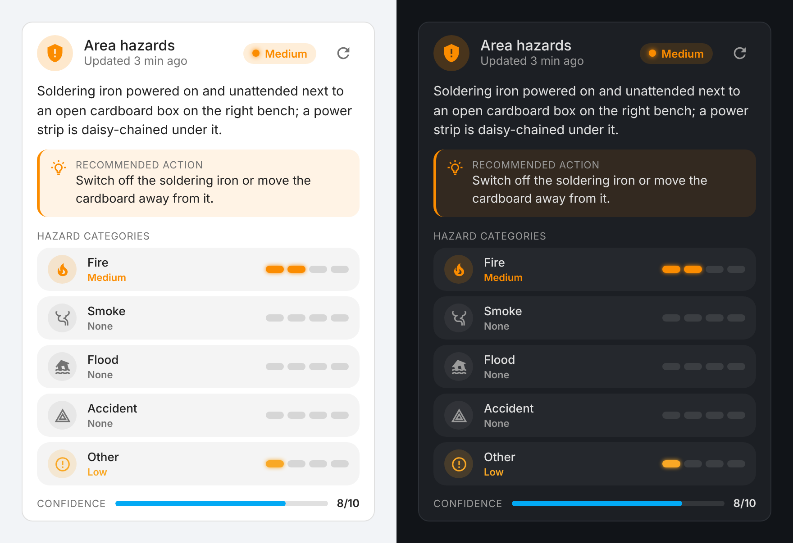
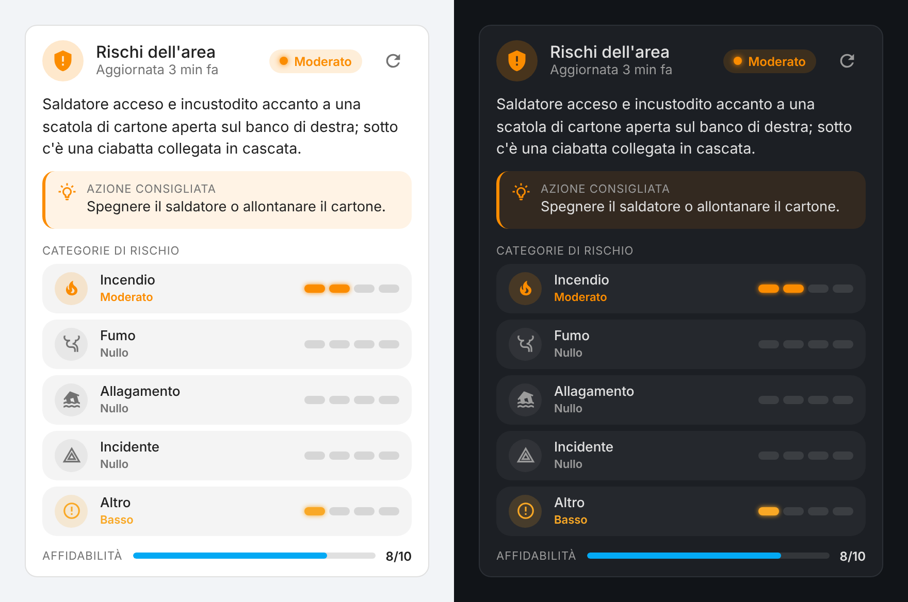

# Hazard Analysis

[](https://hacs.xyz/docs/faq/custom_repositories)
[](https://github.com/artech-lab/ha-hazard-analysis/releases)
[](https://github.com/artech-lab/ha-hazard-analysis/actions/workflows/validate.yml)
[](LICENSE)

**AI safety monitoring for a lab, workshop or garage** from the cameras you already have. An AI vision
model looks at the area on a dynamic schedule, scores five hazard categories from 0 to 4, explains why
and suggests what to do. Pick the cameras and the AI engine, add the card: no helpers, no templates, no
automations, no YAML.

The interface is available in English and Italian; the AI writes its summary in the language of Home
Assistant.



## How it works

```text
cameras + environment sensors  →  AI Task (vision model)  →  validation  →  hysteresis
                               →  entities, alerts, evidence snapshots  →  next analysis in 1-60 min
```

One package contains every step:

- **Analysis** — the integration sends the camera images and the optional sensor readings to an
  [AI Task](https://www.home-assistant.io/integrations/ai_task/) entity with a detailed safety prompt and a
  structured output: `fire`, `smoke`, `flood`, `accident`, `other` (0–4), `confidence` (0–10), a summary and a
  recommended action. Both **active incidents** and **visible precursors** are scored: a soldering iron left on
  next to cardboard, a LiPo charging unattended, a blocked exit, cables across a walkway, liquids on powered
  electronics.
- **Robustness** — out-of-range numbers are clamped (a 7 becomes 4: fail-safe towards an alarm), a missing or
  non-numeric field discards the answer and keeps the previous values, every call has a hard **3-minute
  timeout** and an optional **fallback engine** takes over when the main one is down, fails or hangs.
- **Hysteresis** — a higher level is applied at once; a lower one only after **two consecutive** lower readings,
  so two engines or two frames that disagree do not make the alarm flicker.
- **Dynamic schedule** — the higher the risk, the more often it looks (see [Schedule](#schedule)).
- **Alerts** — a persistent notification on *high* and *critical*, optional push notifications with the camera
  image, and a "cleared" message when the risk goes back down.
- **Evidence** — on *high* or *critical* a snapshot of every camera is saved in the Media folder
  `hazard_analysis`, kept for 30 days.
- **Dashboard card** — served and loaded by the integration itself: no dashboard resource to add, and it is
  always the version that matches the integration.

## Requirements

- Home Assistant 2025.8 or newer.
- One to four `camera` entities looking at the same area.
- An **AI Task entity that accepts images**, from any AI integration: for example
  [Ollama](https://www.home-assistant.io/integrations/ollama/) with a vision model (local),
  [OpenAI](https://www.home-assistant.io/integrations/openai_conversation/),
  [Google Gemini](https://www.home-assistant.io/integrations/google_generative_ai_conversation/) or
  [Anthropic](https://www.home-assistant.io/integrations/anthropic/). Add an *AI Task* service to that
  integration if it has none yet.

> **Privacy** — with a cloud provider the camera images leave your network at every analysis. A local model
> (Ollama) keeps them at home. Tell the people who work in the monitored area.

## Installation

[](https://my.home-assistant.io/redirect/hacs_repository/?owner=artech-lab&repository=ha-hazard-analysis&category=integration)

1. In HACS (*Marketplace* from Home Assistant 2026.11) search for **Hazard Analysis**. If it is not listed,
   add `https://github.com/artech-lab/ha-hazard-analysis` as a custom repository with type **Integration**.
2. Download it and restart Home Assistant.

Manual alternative: copy `custom_components/hazard_analysis` into your `custom_components` folder and restart.

## Setup

[](https://my.home-assistant.io/redirect/config_flow_start/?domain=hazard_analysis)

1. *Settings → Devices & services → Add integration → Hazard Analysis*.

   | Field | Description |
   | --- | --- |
   | Name | Device name and prefix of the entity IDs (default `Hazard monitor`). |
   | Cameras | One to four views of the same area, analysed together. |
   | AI Task entity | Pre-filled with the first AI Task entity that accepts images. |
   | Occupancy sensor | Optional. Triggers an extra analysis when the area becomes occupied and enables the faster schedule. |
   | Area description | Optional context for the AI, e.g. *electronics lab with soldering stations and a 3D printer*. |

2. In a dashboard: *Add card → Hazard Analysis*. The card finds its entities by itself.

   ```yaml
   type: custom:hazard-analysis-card
   entity: sensor.hazard_monitor_risk_level
   ```

The first analysis runs 30 seconds after setup. Add one entry per area to monitor.

### Options

*Settings → Devices & services → Hazard Analysis → Configure* also offers:

| Option | Description |
| --- | --- |
| Fallback AI Task entity | Used when the main engine is unavailable, fails or does not answer within 3 minutes (for example a cloud model behind a local one). |
| Working hours entity | A Workday binary sensor, a `schedule` or any on/off entity: while on, the faster schedule applies. |
| Environment sensors | PM10/PM2.5, CO2, CO, VOC, temperature, smoke, gas or leak sensors of the area. They are given to the AI with reference ranges, as corroboration only: a sensor alone never raises a score. |
| Push notification services | `notify` services that receive the alerts, e.g. `mobile_app_phone`. The image of the first camera is attached. |
| Save evidence snapshots | On by default. |

### Card options

| Option | Default | Description |
| --- | --- | --- |
| `entity` | — | **Required.** The risk level sensor. |
| `name` | "Area hazards" (localized) | Card title. |
| `show_summary` | `true` | AI summary. |
| `show_recommendation` | `true` | Recommended action, hidden when no action is needed. |
| `show_confidence` | `true` | Confidence bar. |
| `show_refresh` | `true` | Button for a new analysis; it spins while one is running. |

The subtitle tells how fresh the analysis is and turns orange when the last attempt failed or no analysis
succeeded for 90 minutes. "De-escalating · awaiting confirmation" appears while a lower reading waits for
its confirmation. Tap the header, a category, the action or the confidence bar to open the related entity.



## Entities

Entity IDs are always in English (shown here with the default name); displayed names follow the language of
Home Assistant.

| Entity | Description |
| --- | --- |
| `sensor.hazard_monitor_risk_level` | `none`, `low`, `medium`, `high` or `critical`: the highest category. Attributes: `level` (0–4), `levels`. |
| `sensor.hazard_monitor_fire`, `_smoke`, `_flood`, `_accident`, `_other` | Level of each category, 0–4. |
| `sensor.hazard_monitor_confidence` | Clarity of the evidence, 0–10. |
| `sensor.hazard_monitor_summary` | Why the levels are what they are. |
| `sensor.hazard_monitor_recommendation` | Corrective action. Attribute `action_required`. |
| `sensor.hazard_monitor_last_analysis` | Time of the last successful analysis. |
| `binary_sensor.hazard_monitor_hazard` | `on` (unsafe) at level 3 or more. |
| `binary_sensor.hazard_monitor_problem` | `on` when the last attempt failed or nothing succeeded for 90 minutes. Attributes `last_error`, `last_attempt`. |
| `binary_sensor.hazard_monitor_analyzing` | `on` while an analysis is running. |
| `binary_sensor.hazard_monitor_deescalation_pending` | `on` while a lower reading waits for confirmation. |
| `button.hazard_monitor_analyze_now` | Runs an analysis right away. |
| `switch.hazard_monitor_monitoring` | Pauses the automatic analyses (the button still works). |
| `sensor.hazard_monitor_analysis_duration` | Diagnostic: duration of the last attempt. |
| `sensor.hazard_monitor_ai_engine` | Diagnostic, disabled by default: the AI Task entity that answered. |

Levels, texts and timestamps are stored and survive restarts. Use the entities in your own automations, for
example to switch off a smart plug when `sensor.hazard_monitor_fire` reaches 3.

## Schedule

Minutes between two analyses, by the current highest level:

| Level | Occupied or working hours | Otherwise (24/7 baseline) |
| --- | --- | --- |
| none (0) | 15 | 60 |
| low (1) | 10 | 30 |
| medium (2) | 5 | 5 |
| high (3) | 2 | 2 |
| critical (4) | 1 | 1 |

Without an occupancy or working hours entity the first column always applies. When the occupancy sensor
turns on, an extra analysis runs (at most one every 10 minutes). After a failed attempt the next one comes
within 5 minutes.

## Scoring

| Level | Label | Meaning |
| --- | --- | --- |
| 0 | none | No visible evidence, sensors normal |
| 1 | low | Minor issue or latent precursor |
| 2 | medium | Notable risk or credible escalation path |
| 3 | high | Serious and immediate danger |
| 4 | critical | Severe, life-threatening condition |

The prompt asks the model to score only direct visual evidence, never the mere presence of people or objects,
to rate any visible flame at least *medium* (at least *high* in a workshop or industrial setting), to keep
post-accident signs (a person on the floor, displaced PPE, a fallen ladder) above zero and to treat sensors as
corroboration only. Confidence measures how clear the evidence is, not how safe the scene is.

> A decision aid, not a certified safety system: it does not replace smoke detectors, gas detectors,
> emergency procedures or people. AI models can miss hazards and can see hazards that are not there.

## Troubleshooting

- **The card is not in the card picker** — reload the browser page once after installing or updating.
- **"No AI Task entity with image support"** — add an AI integration and an *AI Task* service with a vision
  model, then add Hazard Analysis again.
- **`binary_sensor.…_problem` is on** — its `last_error` attribute tells why: timeout, unavailable engine,
  invalid response. Small local models sometimes return incomplete JSON; a larger model or a fallback engine
  helps. Slow answers usually mean the GPU is busy with other AI tasks.
- **Something else** — attach the diagnostics (*device page → ⋮ → Download diagnostics*; they contain no
  images, texts or entity IDs of cameras) to a [new issue](https://github.com/artech-lab/ha-hazard-analysis/issues).

## Contributing

```bash
python -m venv .venv && . .venv/bin/activate && pip install -r requirements_test.txt
scripts/check.sh
```

The version lives only in `manifest.json`; pushing a new one to `main` publishes the release once the checks
pass. See [`CLAUDE.md`](CLAUDE.md) for the layout of the code.

## License

Copyright © 2026 The ha-hazard-analysis contributors. Released under the
[GNU General Public License v3.0 or later](LICENSE).
